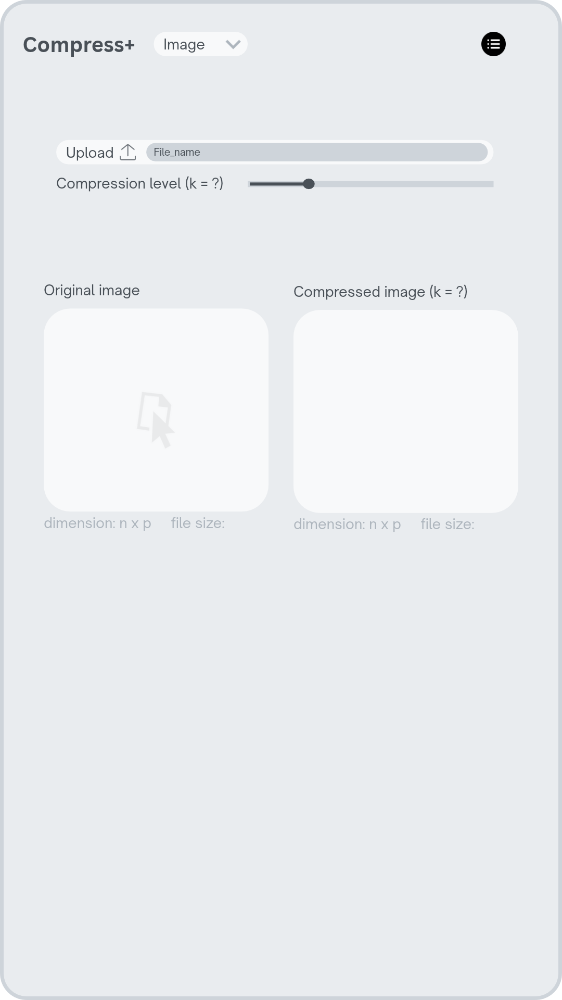

{width=50%}

My app would have two adjacent panels, one for the original image and the other for the compressed image, with their file and panel dimensions labeled respectively below. Above them is a menu with a sliding compression bar and the upload feature.

Users must upload a .csv file to start a session. In any session, the maximum compression level allowed for an image equals to the total number of features (columns) in the file. The compressed image output will automatically update with the k value set using the bar. The user can upload a new file to trigger a new session for a different image, with the k value set from the previous session even if the maximum compression level changes. 